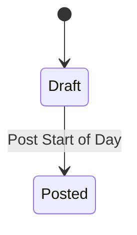
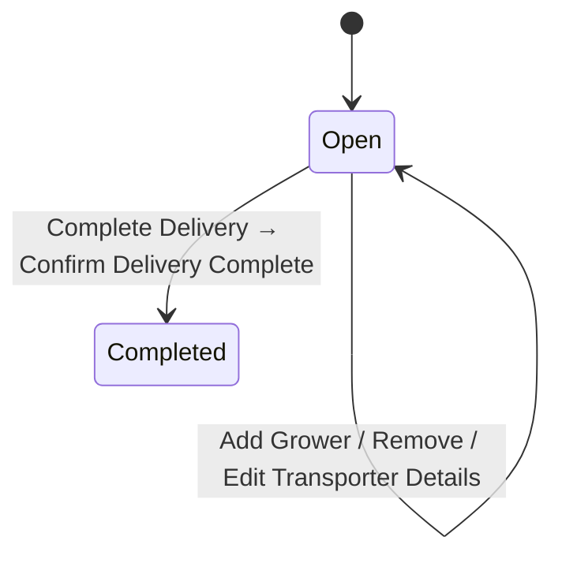
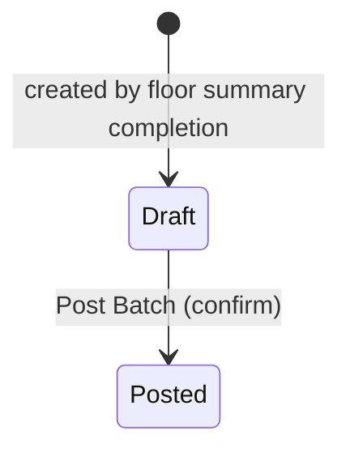
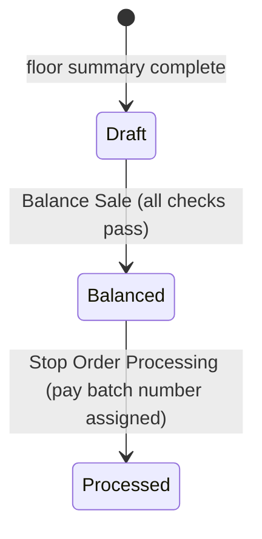
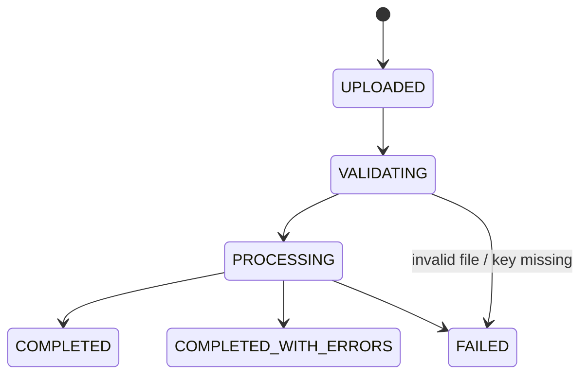
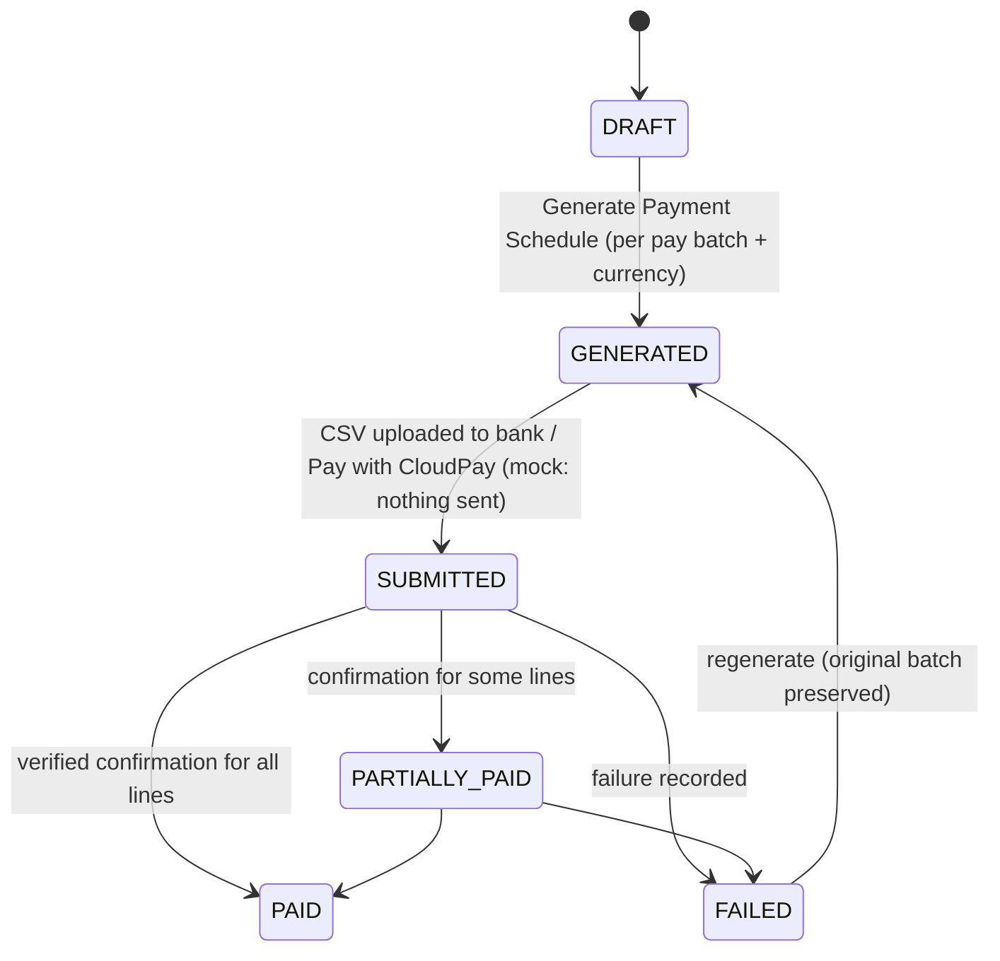

# Status Transitions

Marks: **documented** = shown in a manual; **proposed** = from the brief or our design, not in the manuals. Every transition (in the real backend) validates current state, permission and prerequisites, runs in a transaction, and writes actor, timestamp and an audit entry; the Phase 1 mock imitates this in `mockApi`.

## Overview — delivery vs sale
| Stage | Delivery note (GDN) | Sale |
|---|---|---|
| Growers added, bales being captured | Open | — |
| Delivery completed | Tickets Printing | — |
| Tickets confirmed | Checked | — |
| Floor summary complete | Laid | Draft |
| Batch posted, sale balanced | Laid | Balanced |
| Stop orders processed | Laid | Processed (pay batch number) |

## 1. Receiving sale date
Flags, not a state machine: `isActive` (only one active), `canScanFloorSummary`. Activating unticks the previous (documented, M01).

## 2. Start of Day (documented, M01)

Guards: exchange rate > 0; no Draft/Balanced sales from previous dates. Once posted: edit/un-post not documented.

## 3. Transporter delivery note (TDN) (documented, M03)

Guard: at least one grower (implied). Side effect: one GDN per grower, state Open. Cancellation not documented.

## 4. Grower delivery note (GDN) (documented, M03–M05)

```mermaid
stateDiagram-v2
  [*] --> Open: created on TDN completion
  Open --> TicketsPrinting: grower Complete Delivery (tally = declared)
  TicketsPrinting --> Checked: Confirm Ticket Printing
  Checked --> TicketsPrinting: Reverse Printing Status (supervisor; target implied)
  Checked --> Laid: floor summary scanned = delivered
```

Screens also show a "Laying" status — unexplained (UQ-02). Eject Bale (supervisor) acts on bales while Open.

## 5. Ticket barcode allocation (partly proposed)
Allocated (Set Starting Barcode / Use Next Barcode) → Printed/locked (Confirm Ticket Printing, documented "uses up the barcodes for the season") → (Reverse Printing Status: effect on locks unknown, UQ-11). Interrupted Ticket records last printed + new start.

## 6. Price batch (Batch Processing) (documented, M06)

## 7. Sale (Salesmaster) (documented, M05–M07) + Released flag

- The status bar also shows **Posted** between Draft and Balanced (UQ-02: real state or artefact — likely linked to the price batch being posted).
- **Released** is a separate checkbox on the sale and on each ticket; dispatch requires it (UQ-03). Reversal/adjustment of Balanced/Processed sales referenced but not described (UQ-06).

## 8. Dispatch note (documented states inferred, M09)

```mermaid
stateDiagram-v2
  [*] --> Draft: Create & Add Bales
  Draft --> Posted: Post
  Draft --> Cancelled: Cancel Dispatch (reason)
  Posted --> Draft: Reset to draft (supervisor; rules unknown)
  Posted --> Posted: Generate Shipment File
```

Never deleted. Removing bales only in Draft. Brief-proposed states: DRAFT, POSTED, CANCELLED (same as above).

## 9. Import job (proposed)

Manuals only document outcomes: "N created, N updated, N errors" and "Import complete with errors".

## 10. Payment (proposed; M08 documents only "CSV download does not mark paid" and "CloudPay success marks paid")

Rule: downloading a CSV does not change paid state; a line is Paid only via a recorded confirmation (BR-094).

## 11. Approval request (proposed)
PENDING → APPROVED | REJECTED | CANCELLED; approver ≠ requester unless configured.

Sources: Overview; Manuals 01–09; brief Part 9.
