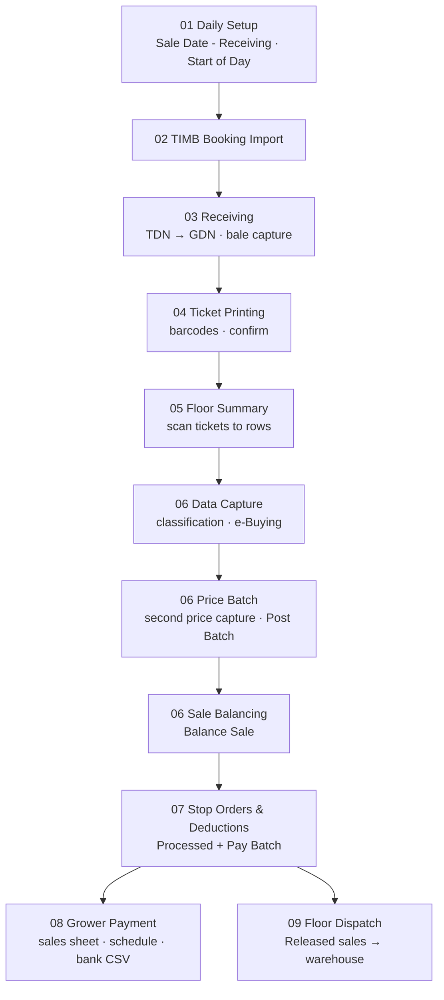

# Sale-Day Lifecycle

The central operational process, as documented across Manuals 01–09. Every stage has its own dedicated interface; the sale-day dashboard (`/dashboard`, `/sale-day`) shows which stage is active, completed, blocked or waiting, and why.

## Stages
| # | Stage | Owner role(s) | Prerequisite (blocks if missing) | Produces | Delivery / sale state |
|---|---|---|---|---|---|
| 01a | Sale Date - Receiving | Receiving supervisor (Supervisor) | Selling point + sale room + receiving rows exist | Active sale date; scan flag | — |
| 01b | Start of Day | Data processing supervisor (Supervisor) | Rate > 0; no Draft/Balanced sales from earlier dates | Posted Start of Day (exchange rate) | — |
| 02 | TIMB booking import | TIMB clerk | Growers in register; original file name | Bookings (created/updated/errors) | — |
| 03 | Receiving | Receiving clerk; Receiving supervisor (corrections) | Active sale date; bookings imported; scale sending weights | TDN, GDNs, captured bales | GDN: Open → Tickets Printing |
| 04 | Ticket printing | Ticket clerk | Active sale date; GDN in Tickets Printing; start barcode | Ticket barcodes (locked for season), printed tickets | GDN: Tickets Printing → Checked |
| 05 | Floor summary | Floor summary clerk; Receiving manager (toggle) | GDN Checked; sale date active with scan flag; scanning on | Floor summary, draft sale, price batch | GDN: Checked → Laid; sale: Draft |
| 06a | Data capture | Classification / Buying clerks | Start of Day posted; Draft sale | Grade, hessian, buyer, buyer grade, price, sale code | sale: Draft |
| 06b | Price batch | Batch clerk (DPS) | Draft sale | Batch prices; Post Batch | batch: Draft → Posted |
| 06c | Balancing | Data processing supervisor | All checks pass; prices match | Balanced sale | sale: Draft → Balanced |
| 07 | Stop orders & deductions | Data processing supervisor; Accounts reviews | Posted Start of Day; Balanced sales; no pending approvals; stop order file for the day | Deduction lines, net payout, pay batch number | sale: Balanced → Processed |
| 08 | Grower payment | Accounts (sales sheets: data processing) | Processed sales; bank details | Sales sheets; payment schedule per currency; bank CSV; confirmations | payment: DRAFT … PAID (proposed) |
| 09 | Floor dispatch | Dispatch clerk / supervisor | Sale Released; warehouses configured | Dispatch note, posted note, shipment file | dispatch: Draft → Posted |

Stages 08 and 09 run in parallel after 07.

## Dashboard blocking rules (what makes a stage "blocked")
| Stage | Blocked when | Message shown |
|---|---|---|
| Start of Day | rate ≤ 0; earlier Draft/Balanced sales exist | MSG-SOD-001 / MSG-SOD-002 |
| Receiving, tickets, floor summary | no active sale date or expired | MSG-SOD-003 / MSG-FLR-002 |
| Floor summary | scanning off | MSG-FLR-001 |
| Data capture / balancing | no posted Start of Day | (derived from BR-006) |
| Stop order processing | exchange rate missing; pending approvals; no stop order file for date | MSG-STO-001 / MSG-STO-002 / MSG-STO-005 |
| Payment | no Processed sales; no receiving sale date or Start of Day | MSG-PAY-001..003 |
| Dispatch | sales not released; no destination warehouse | MSG-DSP-001 |

## Reference run (17 Sep 2026)
SoD @ 26.6845 → bookings EL2609170001/2 → TDN0000002 (V100060 ×3, V100061 ×2) → GDN0000005/GDN0000004 → tickets 1000001013/24/35 and 1000001046/57 → floor rows 1 and 2 → capture (JM, 11OF; 212/198/185) → price batches 4 and 5 → balanced → deductions ($173.11 total incl. $50.00 stop order on V100060) → Processed, pay batch 1001 → schedule → dispatch to CURVERID (DEMO release).

Sources: Overview; Manuals 01–09.
