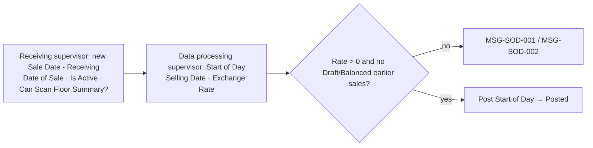
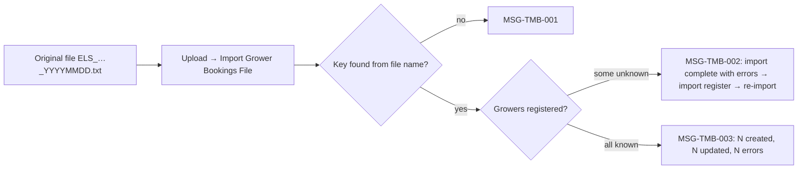
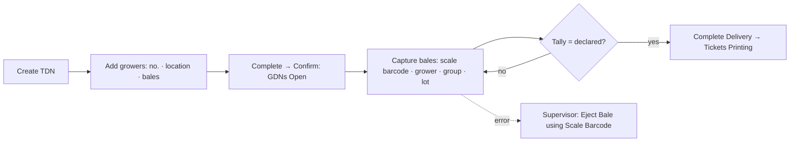
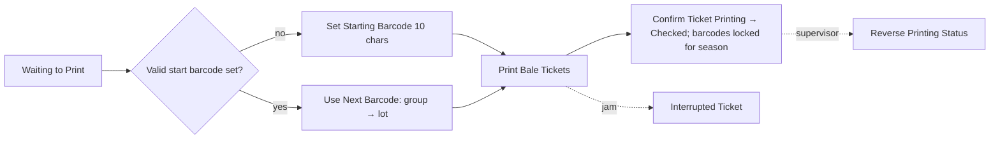
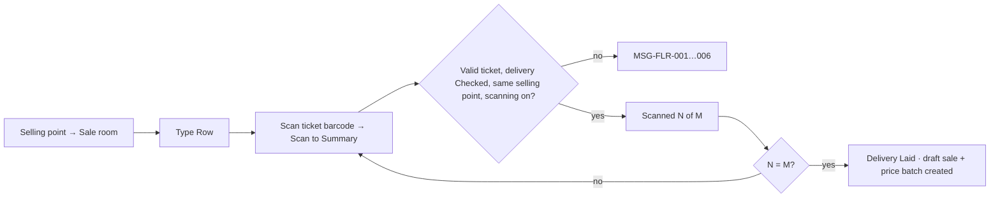
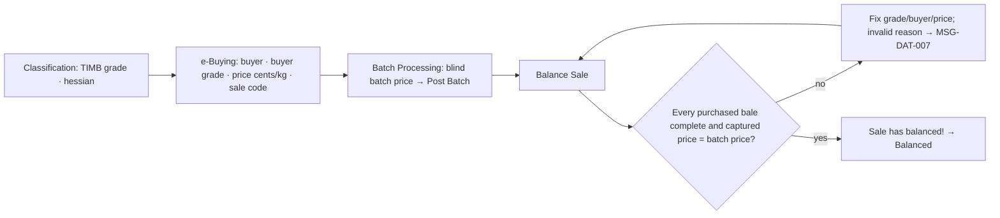
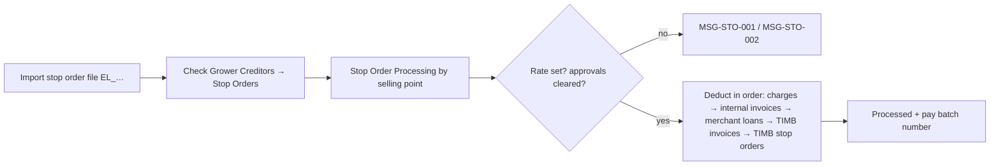

# Stage Flows

One short flow per manual (mermaid). Failure branches use the verbatim messages (see `docs/research/system-messages.md`).

## 01 Daily Setup


## 02 TIMB Booking Import


## 03 Receiving


## 04 Ticket Printing


## 05 Floor Summary


## 06 Data Capture and Balancing


## 07 Stop Orders and Deductions


## 08 Grower Payment
```mermaid
flowchart LR
  SS[Sales sheet Report] --> GS[Generate Payment Schedule: date · batch or 0 · currency]
  GS --> BK{Bank details for grower + currency?}
  BK -- no --> EX[Grower excluded]
  BK -- yes --> CSV[Bank CSV 13 columns]
  CSV --> UP[Upload to bank] --> CONF[Record verified confirmation → Paid]
  GS --> CP[Pay with CloudPay (mock: SUBMITTED, nothing sent)] --> CONF
```
Downloading the CSV never marks growers paid.

## 09 Floor Dispatch
```mermaid
flowchart LR
  IN[Initiate Dispatch: warehouse · product · truck · driver] --> SCN[Scan bale tickets: Save Bale / Remove Bale]
  SCN --> V{Released? right warehouse? not RO/RH/CO? not on another note?}
  V -- no --> E[MSG-DSP-001…007]
  V -- yes --> DONE[Done → Draft note]
  DONE --> POST[Post] --> SF[Generate Shipment File (Posted only)]
  DONE -. wrong .-> CAN[Cancel Dispatch (reason)]
```

Sources: Manuals 01–09.
